  

Plain text

**Aras Tokdemir**, founder of **Çizgi Fikrim**. iOS apps, web SaaS and AI systems, from Turkey.

| Product | What it does | Stack |
|---|---|---|
| PiyasApp | Car culture, social discovery | SwiftUI, Supabase, MapKit, Vision |
| CarLog | Trips, fuel and toll costs | SwiftUI, SwiftData, CarPlay, Live Activities |
| FocusGrid | Focus timer with app blocking | SwiftUI, Screen Time API, WidgetKit |
| FlowGraph | Personal finance tracker | SwiftUI, SwiftData, StoreKit 2, WidgetKit |
| Vesira | AI room redesign | Next.js, TypeScript, Claude API, MCP, Postgres |
| PolishReel | AI product photos and short videos | Next.js, TypeScript, fal.ai, Polar, Postgres |
| ParçaFiyat | Auto parts price and stock for sellers | Chrome Extension, JavaScript, Python, Playwright |
| Ersoy | Cognitive architecture | Python, FastAPI, PyTorch, ONNX, OpenCV |

- **iOS:** Swift, SwiftUI, SwiftData, WidgetKit, Live Activities, CarPlay, Screen Time API, StoreKit 2, MapKit, Vision
- **Web:** TypeScript, Next.js, React, Tailwind, Postgres, Supabase
- **AI:** Claude API, MCP, AI agent teams, PyTorch, ONNX, OpenCV
- **Automation:** Python, FastAPI, Playwright, Chrome Extensions
- **Hardware:** 3D Printing, Home Assistant

<a href="https://cizgifikrim.net">cizgifikrim.net</a>

